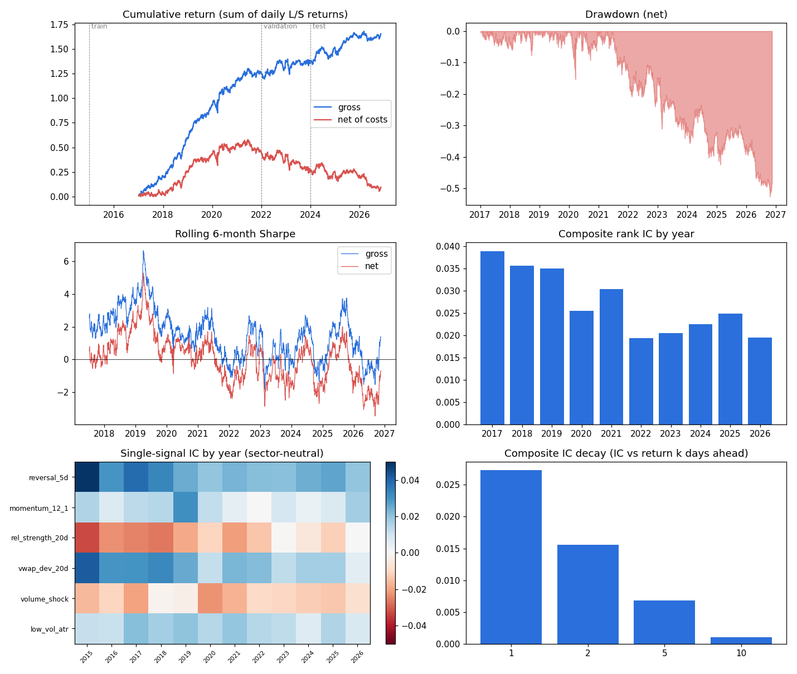

# EdgeSignal — NIFTY 200 signal research

**Question:** do price, volume and earnings signals predict *next-day relative* returns across NIFTY 200 stocks, after Indian trading costs?

**Answer:** they predict, but not by enough to pay for trading. The combined signal has a rank IC of about 0.02 (t = 5.1) on an untouched 2024–2026 test period and passes the leakage checks. Before costs, the market-neutral long-short book has a Sharpe ratio of 1.0. After securities transaction tax (STT), stamp duty, fees and slippage it is −0.5. The edge is mostly 1–2 day reversal, and capturing it means trading more often than delivery-STT allows.



## Results

| Period | IC (t) | Sharpe before costs | Sharpe after costs | Net annual return | Annual cost | Max drawdown (net) | Correlation to NIFTY 200 |
|---|---|---|---|---|---|---|---|
| Train 2017–21 | 0.033 (10.4) | 2.02 | 0.72 | 9.2% | 16.5% | −15% | 0.08 |
| Validation 2022–23 | 0.020 (4.0) | 0.39 | −0.83 | −10.5% | 15.4% | −23% | 0.05 |
| **Test 2024–26** | **0.022 (5.1)** | **1.02** | **−0.51** | **−5.4%** | 16.1% | −29% | 0.05 |

The model is walk-forward ridge regression with 5-day rebalancing, chosen on the validation period. The test period was never used for tuning; every run that printed test numbers is logged in [`test_access_log.csv`](reports/research/test_access_log.csv). Full tables are in [`reports/research/report.md`](reports/research/report.md).

## Method

- **Data:** daily OHLCV for the 200 current constituents from yfinance, 2014 to today, adjusted for splits and dividends. Quarterly results with BSE filing timestamps (2022 onward for NIFTY 200 names) are used for the earnings signals.
- **Signals:** 5-day reversal, 12-1 momentum, 20-day relative strength, VWAP deviation, volume shock and ATR low-volatility. Each day they are winsorized, z-scored and sector-neutralised. Three earnings signals are reported as a separate event study.
- **Timing:** each signal uses data up to day *t*'s close. The trade enters at *t*+1's open and exits at *t*+2's open. Filings and news become usable at the first close after they are *available*. For news that means the later of the published and ingested times.
- **Portfolio:** long the top 20% and short the bottom 20%, dollar-neutral, with each name capped at 2% of the gross book.
- **Costs:** the long leg is costed as cash delivery (STT 0.1% each side; 18.6 bps per unit traded). The short leg is costed as stock futures (9.2 bps per unit traded), because an overnight cash short isn't allowed in India. Both include 7.5 bps of slippage.

## Leakage and robustness checks

| Check | Result |
|---|---|
| Shuffle test (100 within-day permutations of next-day returns) | Sharpe 1.41 → −0.00 ± 0.34; p ≈ 0.01 |
| Trading 0 / 1 / 2 / 5 days late (train Sharpe before costs) | 2.02 / 1.70 / 1.30 / 0.27, a smooth decay |
| Cost multiplier at which the edge disappears | about 1× |
| Choice of rebalance day (test Sharpe after costs) | −0.56 to +0.24 |
| 2020 crash (15 Feb – 30 Apr) | strategy +9.0% after costs vs NIFTY 200 −22.9% |
| Lookahead unit tests on synthetic data | [`engine/tests/test_research.py`](engine/tests/test_research.py) |

## Limitations

- **Survivorship bias.** The universe is today's constituents, so stocks that dropped out of the index are missing.
- **Short-side assumptions.** Every short is assumed to be possible through futures, at cash-price returns, with no basis or roll costs.
- **Fills.** Opening-auction prices are used for fills.
- **Small sample of tests.** 9 signals and 8 model choices were tried. The Bonferroni threshold for that many tests is |t| > 2.97.
- **Sentiment.** Sentiment from RSS, blog and Reddit feeds is evaluated forward-only, not backtested.

## Reproduce

```bash
pip install yfinance duckdb scikit-learn scipy matplotlib pandas
python engine/run_backtest.py          # writes everything to reports/research/
cd engine && python -m unittest discover -s tests   # all engine + research tests
```

The earnings signals need the quarterly-results CSV, passed with `--events PATH`. Without it the script runs on price signals only.

Full write-up, signal log and next steps: [`engine/research/README.md`](engine/research/README.md).

## Repository layout

| Path | What it is |
|---|---|
| `engine/research/` | the daily cross-sectional research pipeline described above |
| `engine/edgesignal/` | intraday paper-trading engine and news/RSS/Reddit/blog intelligence connectors ([engine/README.md](engine/README.md)) |
| `app/`, `worker/` | EdgeSignal web dashboard (`npm install && npm run dev`, Node ≥ 22.13) |
| `reports/research/` | generated results, tearsheet and daily P&L |
